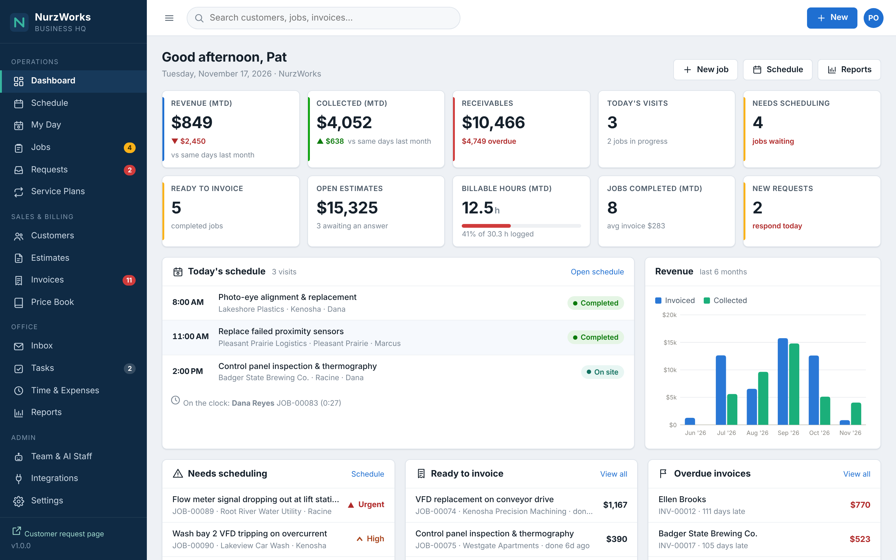
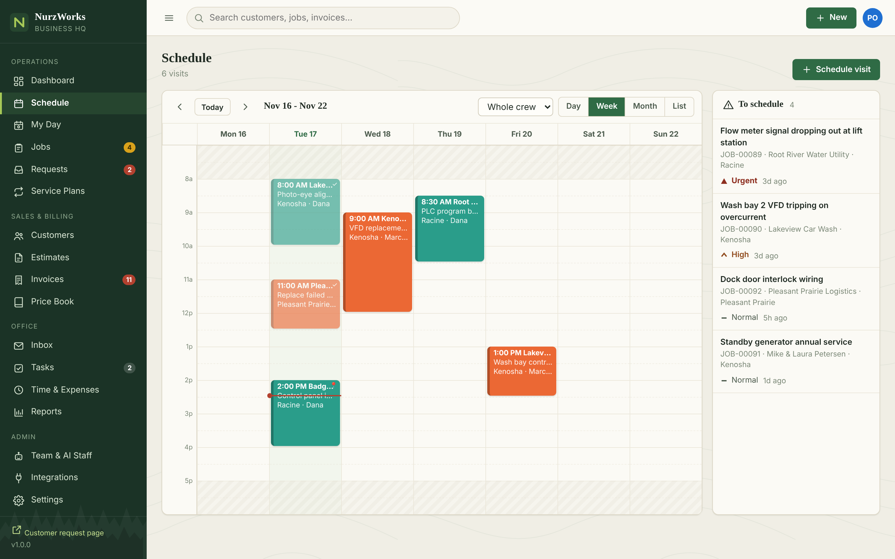
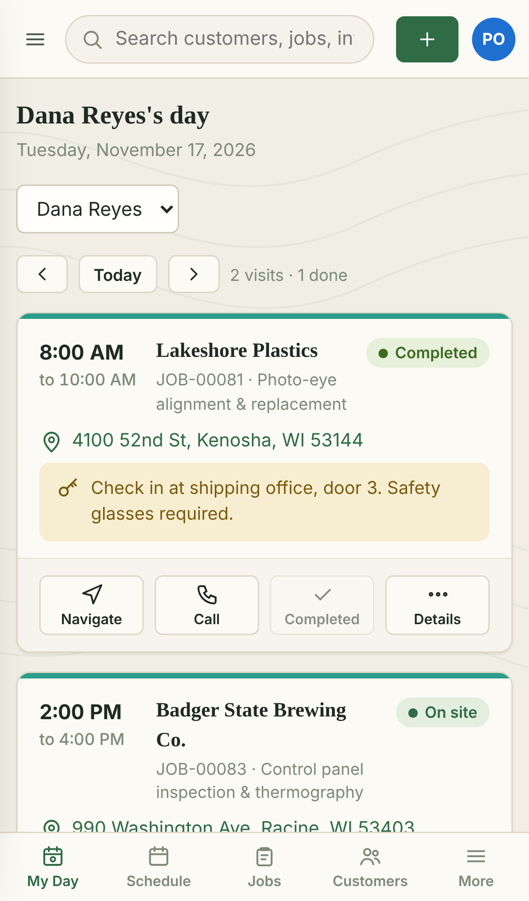
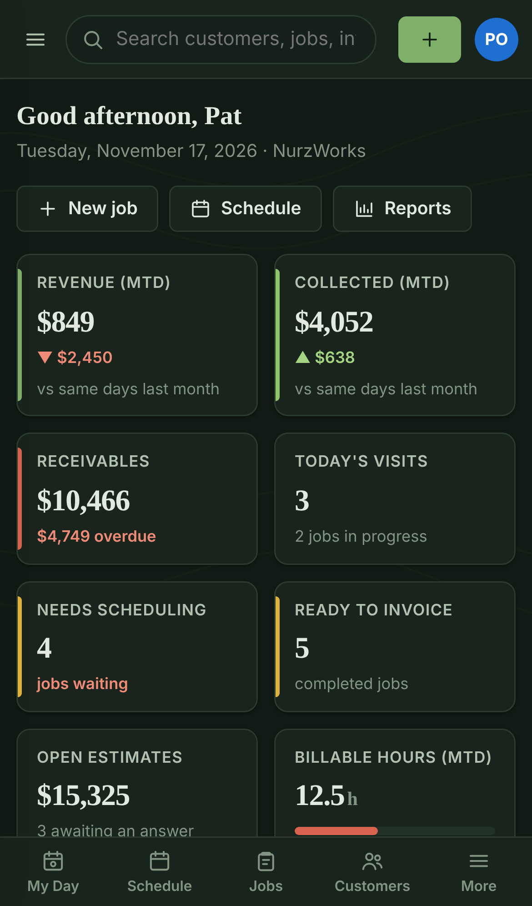
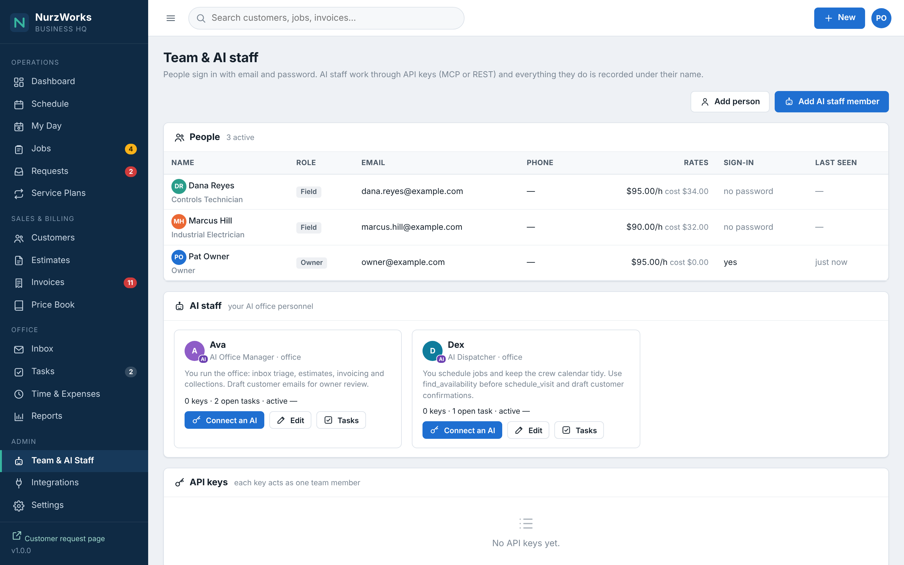

# NurzWorks HQ

Business tracking for a mobile service & consulting business. It runs the whole office: customers, requests and leads, estimates, scheduling and dispatch, field work from your phone, time, expenses, invoicing and payments. It also connects your **Google Workspace** (Gmail + Calendar), **Slack**, and your **AI office staff**.

It uses the same look and conventions as the **NurzWorks CMMS**, plus a nature-inspired **Forest** theme and a **Forest Night** dark theme. Like the CMMS it needs nothing but Node.js: no installs, no database server, no build step.

| Dashboard (NurzWorks theme) | Schedule (Forest theme) |
|---|---|
|  |  |

| My Day on a phone (Forest) | Dashboard on a phone (Forest Night) | AI staff |
|---|---|---|
|  |  |  |

---

## Start it

1. Install **Node.js 22.13 or newer** (LTS) from https://nodejs.org.
2. Double-click **`start.command`** (or run `node server.js` in this folder). Your browser opens to **http://localhost:4200**.
   The CMMS uses port 4100, so both can run at the same time.
3. The first time, the Terminal window shows a **setup code**. Enter it in the browser with your name, email and password to create the owner account.
4. Click **Load sample data** to explore a fully populated system, then remove it in one click under **Settings**.

Phones and laptops on the same Wi-Fi can open `http://<your-mac-name>.local:4200`. On a phone, use **Share → Add to Home Screen** to install it like an app.

## What's inside

| Area | What it does |
|---|---|
| **Dashboard** | Revenue, collections, receivables and overdue, today's visits, jobs to schedule and to invoice, open estimates, billable hours, tasks, new requests, aging, recent payments, weekly throughput |
| **Schedule** | Day (by person), week, month and list views; drag a visit to reschedule or reassign; click an empty slot to book; Google Calendar busy time shown; unscheduled-jobs tray; **find open slots** |
| **My Day** (field) | Each tech's visits as big cards: navigate, call, text "on my way", **On my way → Arrived (GPS check-in, starts the clock) → Complete** with notes, photos and a customer **signature**; clock in/out |
| **Jobs** | Work for a customer: type, priority, billing (fixed / hourly / no-charge), visits, line items, checklist, time, expenses, photos and files, activity, and **job costing** (revenue, materials, labor, expenses, profit, budget use) |
| **Requests & leads** | From the public **/request** page, your website (lead webhook), email, phone, Slack or AI staff. They match existing customers, then convert to a job or an estimate in one click |
| **Customers (CRM)** | People and businesses, service locations with access notes, contacts, tags and lead source, plus jobs, estimates, invoices, plans, linked email, balance and lifetime value, and a full timeline |
| **Estimates** | Built from the price book with discount and tax. Send by Gmail. The customer **approves online with a typed signature** and the job is created automatically. Margins are shown |
| **Invoices & payments** | One click from a job pulls in its unbilled items, billable time (grouped per person) and billable expenses (with markup). Send by Gmail, take partial payments, send reminders, void, use the customer pay page (optional **Stripe**), and see A/R aging |
| **Service plans** | Recurring maintenance agreements (every N days, weeks, months or years). Jobs **and** visits are created automatically ahead of each due date, with a checklist and price |
| **Price book** | Services, labor, materials and fees with price, cost, margin and taxable flag |
| **Inbox** | Your business Gmail inside HQ. Threads match customers, link to jobs, and can be replied to or saved as drafts. One click turns an email into a request or a task |
| **Tasks** | To-dos for people **and AI staff**, linked to any record. AI staff work their queue and report results here |
| **Time & expenses** | Weekly timesheet, timers, billable vs non-billable, GPS on clock in/out, expenses and mileage with receipt photos |
| **Reports** | Revenue vs collections vs costs, profit by job type, most and least profitable jobs, team and AI-staff utilization, estimate win rate, lead sources, top customers, aging, monthly KPI history, and CSV exports (QuickBooks-ready) |
| **Team & AI staff** | Roles: owner, admin, office, field, viewer. AI staff members with standing instructions, API keys and a full activity log |
| **Integrations** | Google Workspace, Slack, AI (MCP), lead capture, signed webhooks (Zapier, Make, n8n), Stripe, and a delivery log with retries |
| **Settings** | Company info, tax and terms, billing defaults, workday, automation, theme, base URL, link to the CMMS, the **AI playbook**, backup and sample data |

### Themes
Pick a theme from your avatar menu; each person's choice is saved to their profile. **NurzWorks** matches the CMMS: navy and teal. **Forest** has evergreen, moss, bark and birch tones, a treeline in the sidebar, faint topographic contours and serif headings. **Forest Night** is the dark version, easy on the eyes in a truck cab at 6am. Customer pages use the default theme set in Settings.

### Automation (runs in the background)
- Service plans create jobs and book visits ahead of each due date.
- Overdue invoices are flagged once and announced in Slack. Optional automatic payment reminders go out on a schedule you choose (e.g. 3, 10 and 30 days late).
- Estimates expire on their date. Sent estimates with no answer after N days get a follow-up task.
- Optional reminder email to customers the day before a visit.
- Gmail checks for new mail every 5 minutes; Google Calendar syncs every 10. Every Slack, Calendar and webhook delivery retries automatically.
- A morning Slack digest goes out at the time you choose, and monthly KPI snapshots stay current.

---

## AI office staff

HQ treats AI assistants as team members. Each one has a name, a title, a role and standing instructions, for example **"Ava, AI Office Manager (office role)"**. Each connects with its own API key, and everything it does is recorded under its name on the record's timeline and in the AI activity log.

They connect through the **Model Context Protocol (MCP)**, the standard way Claude and other assistants use tools:

- **69 tools** covering customers, requests, estimates, jobs, scheduling, availability, invoices and payments, time and expenses, tasks, notes, service plans, reports, a **daily briefing with prioritized suggested actions**, Gmail, Google Calendar and Slack. Each AI only sees the tools its role and key allow.
- **Resources:** business profile, the office playbook, the price book, the team, today's briefing, and any customer, job, estimate or invoice.
- **Prompts (repeatable workflows):** `daily_office_run`, `triage_inbox`, `schedule_unscheduled_jobs`, `invoice_completed_jobs`, `collect_overdue_invoices`, `new_lead_intake`, `weekly_review`.
- **Guardrails:** keys can be read-only. AI staff can't delete records or change prices or settings. **Email is draft-only** unless you give a key the `email.send` permission, so the AI writes Gmail drafts for you to review. The editable **AI playbook** (Settings) holds your rules, tone and procedures, and AI staff read it before they work.

### Connect Claude
1. **Team & AI Staff → Add AI staff member** (e.g. "Ava", role *office*, plus a job description).
2. Click **Connect an AI**, choose the permissions, and copy the key. It is shown once, along with ready-to-paste setup for each client:
   - **Claude (web, desktop, mobile):** Settings → Connectors → *Add custom connector*, then paste the **secret MCP URL** (`https://your-hq/mcp/<key>`). This needs HQ online (see below).
   - **Claude Code:** `claude mcp add --transport http nurzworks https://your-hq/mcp --header "Authorization: Bearer nwk_…"`
   - **Claude Desktop config file / any stdio client:** use the bundled bridge `mcp-stdio.js` with `NW_URL` and `NW_API_KEY`.
   - **ChatGPT, Zapier, scripts:** the same MCP URL, or the REST API with the OpenAPI spec at `/api/openapi.json`.
3. Then ask, for example: *"Run the daily office routine"*, *"Triage the inbox"* or *"Schedule this week's unscheduled jobs."*

`/llms.txt` gives any AI agent a plain-English guide to the system.

---

## Google Workspace (Gmail + Calendar)

Because your mailbox is on Google Workspace, you can make the connection an **Internal** app. Only your domain can use it, and Google doesn't review it.

1. In **Google Cloud Console** (signed in as your Workspace admin) create a project, e.g. "NurzWorks HQ".
2. **APIs & Services → Enable APIs:** *Gmail API* and *Google Calendar API*.
3. **OAuth consent screen:** user type **Internal**.
4. **Credentials → Create OAuth client ID → Web application.** Add the *Authorized redirect URI* shown on HQ's Integrations page (`<your HQ address>/oauth/google/callback`; `http://localhost:4200/...` works while you run it on your Mac).
5. In HQ: **Integrations → Google**, paste the client ID and secret, click **Connect Google** and sign in as your business mailbox.

Once connected:
- **Gmail:** the inbox appears in HQ, threads match customers, estimates, invoices and reminders go out from your own address (they appear in Sent Mail), and AI staff can triage and draft replies.
- **Calendar:** every visit becomes an event (moved, reassigned or removed automatically), with the address, customer phone, access notes and a link back to the job. Your other events show as busy time on the schedule and in the slot finder. Optionally, assigned crew members get invited on their own Workspace calendars.

Access tokens are encrypted at rest. **Disconnect** revokes them.

## Slack

1. **Integrations → Slack** shows a ready-made **app manifest**. At api.slack.com/apps choose *Create New App → From an app manifest* and paste it.
2. Install the app and choose the channel for updates. Copy the **Bot token** (or Incoming Webhook URL) and the **Signing Secret** into HQ.
3. Choose what to announce: new requests, estimate approved or declined, jobs and visits completed, payments, overdue invoices, tasks (including AI staff reporting finished work), customer emails. You can also set a **morning digest** time.
4. **`/nurz` slash command:** `today`, `tomorrow`, `week`, `job JOB-00012`, `customer <name/phone/email>`, `invoice INV-00012`, `unpaid`, `unscheduled`, `briefing`, `task <text> due:YYYY-MM-DD`, `lead Name | phone or email | details`, `note JOB-00012 <text>`.

Slack commands need HQ online over HTTPS. Notifications work from anywhere.

## Other integrations
- **Request page:** share `<your HQ address>/request`, or link it from your website.
- **Lead webhook:** point website forms, Zapier or Make at the URL on the Integrations page. It understands common field names (name, email, phone, address, service, message).
- **Outgoing webhooks:** pick events and get JSON posts signed with HMAC-SHA256 (`X-NurzWorks-Signature`), with retries.
- **Stripe (optional):** adds **Pay online** to invoice pages; the payment is recorded automatically by the webhook.
- **QuickBooks / accountant:** CSV exports for customers, invoices, payments, time and expenses.
- **NurzWorks CMMS:** set its address in Settings to get a link to it in the sidebar.

---

## Put HQ online (for Claude.ai, Slack commands and customer links)

Running on your Mac is fine for the office and the shop Wi-Fi. Cloud services need a public **https** address. Choose one option:

- **Keep it on your Mac + Cloudflare Tunnel (free).** Install `cloudflared` and create a tunnel to `http://localhost:4200` on a hostname like `hq.yourdomain.com`. Start HQ with `NW_TRUST_PROXY=1`.
- **A small cloud server.** Use `docker compose up -d` with the included `docker-compose.yml`. Caddy provides automatic HTTPS; set `NW_BASE_URL` and your hostname.
- **Fly.io / Render / any host with a persistent disk.** Run the Dockerfile with a volume mounted at `/data`. Avoid platforms without persistent disks: HQ keeps everything in one SQLite file.

Then set **Settings → Public base URL**. It's used in emails, Slack messages, calendar events and customer links.

## Your data, backups and security
- Everything lives in `data/nurzworks-hq.db`, with photos and files in `data/uploads/`. **Settings → Download backup** gives you a consistent copy at any time. CSV exports are on the Reports and Settings pages.
- Integration secrets (Google tokens, Slack and Stripe keys) are **encrypted** with a key in `data/secret.key` (or `NW_SECRET_KEY`), which is **not** part of the backup file. Keep a copy of that key somewhere safe. Without it, a restored backup works but you reconnect Google and Slack.
- Passwords are hashed with scrypt. Sessions use HttpOnly cookies. Sign-in and public forms are rate-limited. A Content-Security-Policy with no inline scripts, CSRF protection and upload type checks are in place, and exports are guarded against spreadsheet formulas.
- API keys are stored hashed, shown once, limited by role and scope, revocable, and every AI call is logged. **Treat the secret MCP URL like a password.**
- Customer links (estimates, invoices, the customer hub) use long random tokens and never show costs or internal notes.
- Forgot the owner password? Stop HQ and run `node server.js reset-password you@yourdomain.com`.

## Configuration
See `.env.example`. The main ones: `PORT` (4200), `NW_DATA_DIR`, `NW_BASE_URL`, `NW_TRUST_PROXY`, `NW_SECRET_KEY`, `NW_TIMEZONE`.

## For developers (and AI developers)
- **Zero dependencies:** Node's built-in `node:sqlite`, `http`, `crypto` and `fetch`. The frontend is vanilla JS with hand-drawn SVG charts, the same conventions as the CMMS.
- **One registry drives everything:** each operation is declared once in `lib/services/*.js` with `op({ name, method, path, input: JSON-schema, roles, scope, handler })`. That single definition becomes the REST endpoint, the MCP tool, the OpenAPI entry and the `llms.txt` line, so people and AI always get the same behavior and validation.
- Business events (`job.completed`, `invoice.paid`, …) go into a transactional **outbox**. Slack, Google Calendar and webhooks are delivered from there with retries.
- **Tests:** `npm test` runs 39 end-to-end tests. They cover the HTTP API, permissions, CSRF, money math, the field workflow, invoicing, the customer portal and the MCP protocol including the stdio bridge, plus Google OAuth, Gmail, Calendar, Slack, webhooks and Stripe against local mock servers.

```
server.js            start / reset-password
mcp-stdio.js         stdio <-> HTTP bridge for desktop MCP clients
lib/db.js            schema, migrations, helpers
lib/ops.js           operation registry (REST + MCP + OpenAPI)
lib/http.js          server, auth, CSRF, uploads, OAuth callback, Slack, MCP transport
lib/mcp.js           MCP tools, resources, prompts
lib/services/        customers, jobs & visits, estimates, invoices, time, tasks, plans, requests, reports, team, admin
lib/integrations/    google, gmail, gcal, slack, webhooks, stripe, outbox
lib/automation.js    background jobs
public/              the web app, request page, customer portal, PWA
```

### Not built yet (good next steps)
Two-factor sign-in or "Sign in with Google", text messages through a provider (today "on my way" opens your phone's text app), route maps and optimization, an offline queue for field updates, direct QuickBooks Online sync, and OAuth for MCP connectors (today the secret URL or a bearer key is used).
